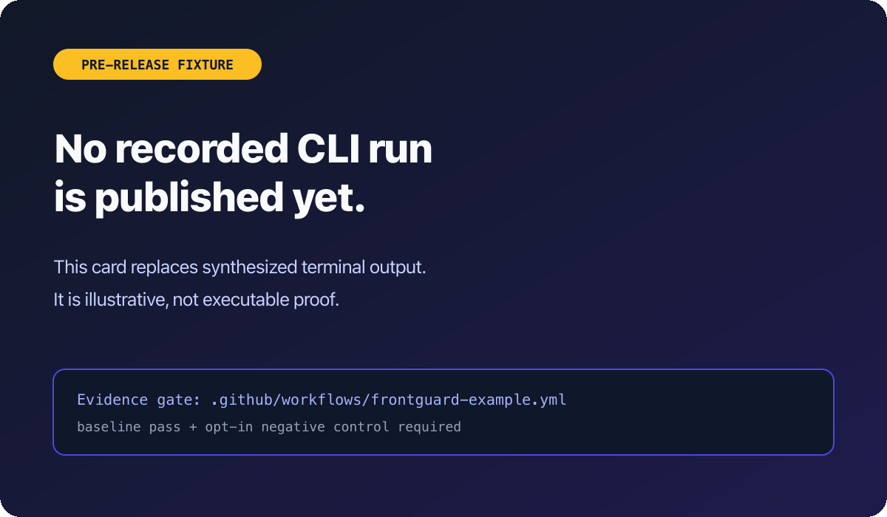

# 🛡️ Frontguard

[](https://github.com/ravidsrk/frontguard/actions/workflows/ci.yml)
[](https://www.npmjs.com/package/@frontguard/cli)
[](https://www.npmjs.com/package/@frontguard/playwright)
[](./LICENSE)

**Local visual regression testing with reviewed git baselines, inspectable reports, and optional model-assisted analysis.** On the default compare path, pixel comparison is the pass/fail signal. Model classification is advisory and unmeasured. Experimental `frontguard run --mode judge --experimental` is a separate opt-in and is not that path. Its notes are advisory. The protocol is [docs/judge-protocol.md](docs/judge-protocol.md).

Frontguard gives frontend teams a local, inspectable screenshot comparison loop without requiring a hosted account.

> **multi-browser** · **optional AI vision analysis** · **local-first** · **MIT**
>
> _Current test, source, version, and bundle metrics are derived by [`scripts/stats.ts`](./scripts/stats.ts). See [`scripts/stats.json`](./scripts/stats.json) for the canonical snapshot._

<p align="center">
  <br/>
  <em>📽️ Demo: <code>frontguard init</code> → <code>doctor</code> → <code>run</code> → AI classification.</em>
</p>

> ### Published package line: 0.2.2
>
> Published packages are listed in [CHANGELOG.md](./CHANGELOG.md). The first validation run is documented in [`validation/results-v0.2.md`](./validation/results-v0.2.md): 39 of 43 route rechecks completed across 2 of 5 fixture repositories on one macOS host, with AI disabled. It is not an AI-accuracy or cross-OS benchmark.

---

## Choose Your Workflow

Frontguard is organized as modular npm packages so you can adopt the exact level of visual testing your project needs:

| Workflow | Package | When to Use It | Where Baselines Live |
| :--- | :--- | :--- | :--- |
| **1. Full-App & Sitemap CLI** | [`@frontguard/cli`](https://www.npmjs.com/package/@frontguard/cli) | Crawl or list routes in `frontguard.config.ts` (plus optional Storybook `/index.json`, Ladle `meta.json`, or Histoire `histoire.json`), capture multi-viewport screenshots, and gate PRs in CI. | `frontguard-baselines` git orphan branch (zero `main` branch binary bloat) |
| **2. In-Test Playwright Helper** | [`@frontguard/playwright`](https://www.npmjs.com/package/@frontguard/playwright) | Call `await visualTest(page, name, options)` directly inside existing `@playwright/test` spec files after login flows, modals, or mocked API responses. | `__visual_baselines__/` directory |
| **3. AI Coding Agent Loop** | [`@frontguard/mcp`](https://www.npmjs.com/package/@frontguard/mcp) | Let Claude Code, Cursor, or Windsurf inspect visual regressions, spatial DOM diff clusters (`cluster.targetSelector`), and validate CSS patches over stdio. | Reads `./frontguard-report/report.json` locally (zero Cloud API key required) |

---

## Quick Start (`@frontguard/cli`)

**Prerequisites:** [Node.js](https://nodejs.org/) 22+, a git repository, and an `origin` remote if CI should compare against published baselines. Frontguard stores screenshots on the `frontguard-baselines` orphan branch.

### Step 1: Install Chromium & Initialize Config

```bash
# One-time per machine: install the Chromium browser Frontguard uses to render pages
# (--with-deps installs Linux system packages; on macOS the dependency
# warning is safe to ignore.)
npx -p @frontguard/cli playwright install --with-deps chromium

# Generate frontguard.config.ts (--yes skips prompts).
# Add --ci only if this repo already has package.json, a start script,
# and a supported lockfile (set package.json "packageManager" if more than
# one lockfile exists) — otherwise `init --ci` writes nothing.
npx -p @frontguard/cli frontguard init --yes
npx -p @frontguard/cli frontguard doctor

# Commit only the files init wrote. The published CLI needs a clean tree
# to create the baseline branch.
git add frontguard.config.ts .gitignore && git commit -m "Add Frontguard"
```

Check the `routes` in `frontguard.config.ts` before capturing: for non-framework apps `init` guesses (`/`, `/about`, `/contact`), and a route that does not exist baselines its 404 page without warning.

### Step 2: Start Your App Server (Terminal A)

Leave your dev server running until the `baseUrl` in `frontguard.config.ts` responds (a static folder via `npx serve` works too):

```bash
npm run dev
```

### Step 3: Capture Baselines & Run Comparison (Terminal B)

Review the running app in your browser, capture baselines with `update-baselines`, then compare with `run`. Local comparison needs no `origin` remote:

```bash
npx -p @frontguard/cli frontguard update-baselines --confirm-baselines
npx -p @frontguard/cli frontguard run
```

Only CI comparisons need the published orphan branch:

```bash
git push origin frontguard-baselines
```

`run` exits `0` when pages match, `1` on a regression or unaccepted new page, and `2` on a tool error. `update-baselines` and `run --update-baselines` also exit `2` and write nothing unless a human passes `--confirm-baselines`. Judge mode cannot supply that flag, and an advisory caption cannot set it. An agent setting `confirm_reviewed: true` on itself is not a human review. The default `threshold` is `0.1` (10% changed pixels), so a small visible change still passes — lower it (e.g. `0.01` = 1%) for stricter pages.

### Merge queue

Register the pull request check and the merge queue on one workflow, with the same job name. GitHub waits for that name on the queue:

```yaml
on: [pull_request, merge_group]

jobs:
  visual-regression:
    runs-on: ubuntu-latest
```

A workflow-level `paths:` filter on that required check skips the job when the queue commit does not touch those paths, and the queue stays pending. Do not put `paths:` on a required Frontguard check.

Queue runs compare against the shared latest `frontguard-baselines` branch until [#306](https://github.com/ravidsrk/frontguard/issues/306). They do not auto-pass. `update-baselines: true` on `merge_group` exits 2 and pushes nothing, even if `allow-baseline-writes` is `true`.

Capture the PR head SHA (`github.event.pull_request.head.sha` on pull requests, `github.event.merge_group.head_sha` in the queue). Check out with `fetch-depth: 0`. smartFilter's `git diff <base>...HEAD` needs that base commit in the clone; `fetch-depth: 1` does not include it. On `merge_group` the Action passes `--all-routes` and, when the payload has one, sets `FRONTGUARD_DIFF_BASE` from `github.event.merge_group.base_sha`.

> **Full documentation:** [frontguard.dev/docs](https://frontguard.dev/docs) · [Quick Start](https://frontguard.dev/docs/quick-start) · [CLI Configuration](https://frontguard.dev/docs/cli/configuration) · [Playwright API](https://frontguard.dev/docs/playwright/api) · [MCP Server](https://frontguard.dev/docs/integrations/mcp)

---

## Practical Developer Recipes

### 1. Eliminating Flaky Renders (Clocks, PRNG, Third-Party Widgets & Frame Convergence)

Lock down time-dependent UI, random charts/IDs, and third-party analytics/chat widgets in `frontguard.config.ts`:

```typescript
// frontguard.config.ts
export default {
  version: 1,
  baseUrl: 'http://localhost:3000',
  routes: ['/', '/pricing', '/dashboard'],
  viewports: [375, 768, 1440],
  browsers: ['chromium'],
  colorScheme: 'dark',

  // Deterministic stabilization controls:
  waitForStability: true,               // Poll consecutive frames until pixel variance < 0.05%
  redactSensitive: true,                // Mask password/email/token inputs & scrub DOM snapshots
  freezeTime: '2026-01-01T00:00:00Z',   // Lock page.clock and Date.now() (boolean | epoch ms | ISO string)
  seedRandom: 42,                       // Override Math.random() with deterministic Mulberry32 PRNG
  blockUrls: [                          // Abort flaky third-party network requests during render
    '*google-analytics.com*',
    '*googletagmanager.com*',
    '*intercom.io*',
  ],

  // Hide dynamic elements that still vary:
  ignore: [
    { selector: '.live-latency-ticker' },
  ],

  threshold: 0.01, // 0.01 = 1% changed-pixel ratio
}
```

### 2. Testing Interactive States (Modals, Tabs & Forms) Before Screenshot Capture

Execute Playwright UI actions per route before Frontguard checks frame stability and captures the PNG:

```typescript
// frontguard.config.ts
export default {
  version: 1,
  baseUrl: 'http://localhost:3000',
  routes: [
    '/',
    {
      path: '/pricing',
      threshold: 0.005, // Stricter 0.5% threshold on pricing
      actions: [
        { type: 'waitForSelector', selector: '[data-ready]' },
        { type: 'click', selector: '[data-billing="annual"]' },
      ],
    },
    {
      path: '/settings',
      actions: [
        { type: 'fill', selector: 'input[name="filter"]', value: 'security' },
        { type: 'click', selector: '[data-testid="open-token-modal"]' },
        { type: 'waitForSelector', selector: '[role="dialog"]' },
      ],
    },
  ],
}
```

### 3. Component-Scoped Visual Assertions Inside Playwright Tests (`@frontguard/playwright`)

Use `visualTest(page, name, options)` inside your existing `@playwright/test` suites to test specific components, inspect 8-connected spatial diff clusters (`result.clusters` with `targetSelector`), and capture ARIA snapshots:

```typescript
import { test, expect } from '@playwright/test';
import { visualTest } from '@frontguard/playwright';

test('pricing tier card remains visually stable', async ({ page }) => {
  await page.goto('http://localhost:3000/pricing');
  await page.getByRole('tab', { name: 'Annual' }).click();

  const result = await visualTest(page, 'pricing-annual-card', {
    selector: '[data-testid="pro-tier-card"]',
    threshold: 0.01,
    waitForStable: true,
    freezeTime: '2026-01-01T00:00:00Z',
    seedRandom: 42,
    blockUrls: ['*intercom.io*'],
    redactSensitive: true,
    captureAriaSnapshot: true,
  });

  if (!result.passed && result.clusters?.length) {
    console.error(
      'Regressed DOM selectors:',
      result.clusters.map((c) => `${c.targetSelector} (${c.bbox.width}x${c.bbox.height})`),
    );
  }

  expect(result.passed).toBe(true);
});
```

### 4. Multi-Provider BYOK Vision Analysis (OpenAI, Anthropic, Gemini & Local Ollama)

AI analysis is optional. When configured, Frontguard sends screenshot evidence to your selected provider and returns an advisory classification (`regression`, `intentional`, `content_update`), confidence score, and explanation:

```typescript
// frontguard.config.ts
export default {
  version: 1,
  baseUrl: 'http://localhost:3000',
  redactSensitive: true,
  ai: {
    provider: 'openai',
    model: 'gpt-4o', // Or 'gpt-4.1-mini'
    // Or provider: 'gemini', model: 'gemini-2.5-flash' (env: FRONTGUARD_GEMINI_KEY)
    // Or provider: 'anthropic', model: 'claude-sonnet-4-20250514' (env: FRONTGUARD_ANTHROPIC_KEY)
    // Or point baseUrl at OpenRouter, local Ollama ('http://localhost:11434/v1'), or vLLM
  },
}
```

### 5. Connecting AI Coding Agents via `@frontguard/mcp` (Zero-Key Local Mode)

Generate the local JSON report from your project directory (JSON goes to stdout):

```bash
mkdir -p frontguard-report
npx -p @frontguard/cli frontguard run --output json > frontguard-report/report.json
```

Refresh this file after each comparison. Exit 1 can still produce a regression report; investigate exit 2 before using the report.

Add `@frontguard/mcp` to `.mcp.json` (Claude Code, Cursor, or Windsurf). In local report mode, it reads `./frontguard-report/report.json` directly with zero Cloud API setup:

```json
{
  "mcpServers": {
    "frontguard": {
      "command": "npx",
      "args": ["-y", "@frontguard/mcp"],
      "env": {
        "FRONTGUARD_LOCAL_REPORT": "./frontguard-report/report.json"
      }
    }
  }
}
```

Available MCP tools by default: `list_regressions`, `inspect_diff_cluster_dom`, `get_suggested_fix`, `verify_css_patch`, and `recent_runs`. `promote_baseline` and `accept_baseline` are registered only when `FRONTGUARD_MCP_WRITES=1`. Local-report mode refuses promotion and does not write `frontguard-baselines`; the CLI command above is the local write. Cloud `approveRun` is not a production path.

### 6. Accessibility (WCAG), Performance Budgets & Script Drift Audits

Frontguard ships a 9-hook plugin pipeline (`setup`, `beforeDiscover`, `afterDiscover`, `beforeRender`, `afterRender`, `afterCompare`, `afterRun`, `onError`, `teardown`) and built-in plugins for accessibility, performance budgets and third-party scripts. The accessibility plugin audits route/viewport pairs in fresh Chromium pages after screenshot capture:

```typescript
// frontguard.config.ts
import {
  createAccessibilityPlugin,
  createPerfBudgetPlugin,
  createThirdPartyScriptPlugin,
} from '@frontguard/cli/plugins';

export default {
  version: 1,
  baseUrl: 'http://localhost:3000',
  routes: ['/', '/pricing', '/checkout'],
  plugins: [
    createAccessibilityPlugin({ impact: 'serious', failOnViolation: true }),
    createPerfBudgetPlugin({ budgets: { lcp: 2500, cls: 0.1 } }),
    createThirdPartyScriptPlugin(),
  ],
};
```

---

## CLI Commands & Flags Reference

| Command                              | Description                                                                             |
| ------------------------------------ | --------------------------------------------------------------------------------------- |
| `frontguard run`                     | Run visual regression tests (default command)                                           |
| `frontguard init [--ci] [--yes]`     | Generate a starter config; `--ci` also writes a GitHub Actions workflow                 |
| `frontguard doctor`                  | Diagnose environment readiness (Node, Playwright, browsers, config, git)                |
| `frontguard guide [topic] [--json]`  | Print offline reference guides (`setup`, `diffing`, `mcp`, `playwright`, `ci`)          |
| `frontguard update-baselines --confirm-baselines` | Accept current screenshots as new baselines. Exits 2 and writes nothing without the flag. |
| `frontguard monitor`                 | Monitor live production URLs for visual regressions                                     |
| `frontguard accept-fix <id>`         | Mark a suggested fix as accepted (improves future suggestions)                          |
| `frontguard reject-fix <id>`         | Mark a suggested fix as rejected (negative training signal)                             |
| `frontguard export-patterns`         | Export the local fix-pattern database as JSON                                           |
| `frontguard plugin install <name>`   | Install a Frontguard plugin from npm                                                    |
| `frontguard plugin uninstall <name>` | Uninstall a Frontguard plugin                                                           |
| `frontguard plugin list`             | List installed plugins                                                                  |

### Key `frontguard run` Flags

- `--url <url>` — Override `baseUrl` from `frontguard.config.ts` (for preview or staging deployments)
- `--threshold <ratio>` — Changed-pixel ratio threshold on a `0–1` scale (`0.01` = 1%)
- `--wait-for-stability` — Wait for consecutive animation frames to converge before capturing
- `--redact-sensitive` — Redact password, payment, and `[data-frontguard-redact]` inputs and scrub DOM snapshots before capture
- `--color-scheme <scheme>` — Emulate `light` or `dark` `prefers-color-scheme`. This compares against the same baseline file as the default scheme until named capture modes exist.
- `--freeze-time [timestamp]` — Freeze `Date.now()` / `new Date()` (boolean default, epoch ms, or ISO 8601 date string)
- `--seed-random [seed]` — Seed `Math.random()` with a deterministic PRNG (`true` or numeric seed)
- `--block-urls <patterns...>` — Abort matching third-party / analytics / ad request URLs during render
- `--output <console|json>` — Emit human-readable console report or structured JSON to stdout
- `--all-routes` — Render every discovered route. Skips smartFilter for this run and leaves animation freeze and font waiting on. The merge-queue Action passes it on `merge_group`.

### Sample CLI Output

```
 frontguard

 🔍 Discovering routes... found 47 routes
 📊 12/47 routes affected by changed files
 🖥  Rendering 12 routes × 3 viewports

 ───────────────────────────────────────────
  RESULTS                        12 routes
 ───────────────────────────────────────────
  ✓ /                375  768  1440   PASS
  ✓ /pricing         375  768  1440   PASS
  ⚠ /checkout        375  768  1440   WARNING
  ✘ /dashboard       375  768  1440   REGRESSION
  ★ /settings        375  768  1440   NEW
 ───────────────────────────────────────────

  ✘ /dashboard @ 375px
    AI: "At 375px, the current screenshot shows the sidebar overlapping
         the main content; the baseline keeps both regions separate."
    Guidance: Review responsive stacking for this viewport.
    Severity: 🔴 Critical (confidence: 94%)

  1 regression · 1 warning · 9 passed · 1 new
```

---

## Built in the Open

The MIT-licensed repository contains the CLI, optional AI pipeline, cloud API source, integrations, MCP server, and Docker renderer source. The local CLI is the supported product path. Hosted, MCP, GitHub App, and Docker Compose onboarding remain pre-release; see the [launch audit](./docs/launch-audit-2026-08.md) for the unresolved acceptance work.

AI is optional; without it, the CLI performs local pixel comparison and writes local reports. Cloud source and the [self-host guide](https://frontguard.dev/docs/self-host) are available for evaluation, not as a verified production quick start.

## How Frontguard Compares

| | Frontguard | Percy | Chromatic | BackstopJS | Lost Pixel | Argos |
|---|:---:|:---:|:---:|:---:|:---:|:---:|
| Open source | ✅ MIT | ❌ | ◐ | ✅ | ◐ (read-only) | ✅ MIT |
| CLI-first | ✅ | ❌ | ❌ | ✅ | ✅ | ✅ |
| **AI change classification** | ✅ optional | ◐ | ❌ | ❌ | ❌ | ❌ |
| AI fix verification | ◐ experimental | ❌ | ❌ | ❌ | ❌ | ❌ |
| Multi-render consensus | ◐ configurable | ◐ | ◐ | ❌ | ❌ | ◐ |
| Runs without a hosted service | ✅ | ❌ | ❌ | ✅ | ◐ | ◐ |
| Free tier | Forever (CLI) | 5k screenshots/mo | 5k snapshots/mo | Free | Sunset | 5k screenshots/mo |
| Hosted entry | Waitlist | $199/mo | $179/mo | n/a | n/a | $100/mo |
| Project status | Active | Active | Active | Low activity observed | Sunset; team joined Figma | Active |

> Migrating? See the [BackstopJS](https://frontguard.dev/docs/guides/migrate-from-backstopjs), [Lost Pixel](https://frontguard.dev/docs/guides/migrate-from-lost-pixel), and [Argos](https://frontguard.dev/docs/comparisons/frontguard-vs-argos) guides. Comparisons: [Percy](https://frontguard.dev/docs/comparisons/frontguard-vs-percy) · [Chromatic](https://frontguard.dev/docs/comparisons/frontguard-vs-chromatic) · [Argos](https://frontguard.dev/docs/comparisons/frontguard-vs-argos).

---

## Repository Architecture

```
packages/
├── cli/src/          # @frontguard/cli — discover → render → diff → report
│   ├── cli/          # Commander entry (run, init, update-baselines, doctor, guide, monitor)
│   ├── core/         # Pipeline orchestrator, types, config, 9-hook plugin system
│   ├── discovery/    # Route discovery (crawler + filesystem + optional Storybook, Ladle, Histoire indexes)
│   ├── render/       # Playwright rendering engine + deterministic anti-flake gates
│   ├── diff/         # Pixelmatch + SSIM / Chroma-SSIM / CW-SSIM + DOM cluster attribution
│   ├── storage/      # Git orphan branch baselines (frontguard-baselines)
│   ├── report/       # Console, JSON, 4-mode HTML workbench, GitHub PR reporters
│   ├── plugins/      # Accessibility, perf budgets, third-party scripts, Figma, monitor
│   └── utils/        # Redaction, logging, retry
├── playwright/       # @frontguard/playwright — in-test visualTest() assertion helper
├── mcp/              # @frontguard/mcp — 7-tool MCP server (local report + Cloud API)
├── cloud-api/        # Cloudflare Workers + D1 + R2 (/v1/runs, /v1/baselines, /v1/cas)
└── create-frontguard-plugin/
apps/
├── web/              # Documentation & product site (frontguard.dev)
└── demo/             # Next.js regression fixture app
```

## Telemetry

Anonymous usage telemetry is **off by default**. Nothing is sent unless you opt in with `FRONTGUARD_TELEMETRY=1` or `telemetry: true` in config.

Opt out with any of `--no-telemetry`, `FRONTGUARD_TELEMETRY=0`, `DO_NOT_TRACK=1`, or `telemetry: false`.

When enabled, the CLI POSTs one JSON event to `https://telemetry.frontguard.dev/v1/events` (override with `FRONTGUARD_TELEMETRY_ENDPOINT`). Fields: `command`, `version`, `routes`, `regressions`, `aiProvider`, `antiFlake`, `ci`, `durationMs`, `errorType`, `ts`. No URLs, paths, screenshots, or keys. The HTTP peer can see the source IP. There is no published retention period for the default collector.

Full schema: [docs/telemetry.md](./docs/telemetry.md).

Capture and compare traces are separate from those events. They are sent only when `OTEL_EXPORTER_OTLP_ENDPOINT` is set, as OTLP/HTTP JSON to that collector. Each span records a screenshot count and no URL, path, or image.

## Environment Variables

```bash
# AI Analysis (optional, BYOK — bring your own key, pick one)
FRONTGUARD_OPENAI_KEY=sk-...
FRONTGUARD_ANTHROPIC_KEY=...
FRONTGUARD_GEMINI_KEY=AIza...
FRONTGUARD_OPENAI_BASE_URL=https://openrouter.ai/api/v1 # optional OpenAI-compatible endpoint

# Local Report Mode for @frontguard/mcp (optional, auto-detects ./frontguard-report/report.json)
FRONTGUARD_LOCAL_REPORT=./frontguard-report/report.json

# Opt-in anonymous usage telemetry (off by default unless set)
FRONTGUARD_TELEMETRY=1
FRONTGUARD_TELEMETRY_ENDPOINT=https://telemetry.frontguard.dev/v1/events
DO_NOT_TRACK=1

# Optional OTLP traces (off unless set; counts only, no screenshots)
OTEL_EXPORTER_OTLP_ENDPOINT=https://otel.example.com
OTEL_EXPORTER_OTLP_HEADERS=api-key=replace-me
```

## Documentation & Internal References

- **Interactive Developer Docs:** [frontguard.dev/docs](https://frontguard.dev/docs)
- [Product deep-dive](./docs/PRODUCT.md) — Architecture decisions and design rationale
- [Research](./docs/research.md) — Competitive landscape and pricing citations
- [Validation results](./validation/results-v0.2.md) — Recorded local harness run
- [Telemetry schema](./docs/telemetry.md) — Opt-in anonymous event contract

## Contributing & License

Contributions welcome! See [CONTRIBUTING.md](./CONTRIBUTING.md) for development setup and guidelines. Released under the [MIT License](./LICENSE).
